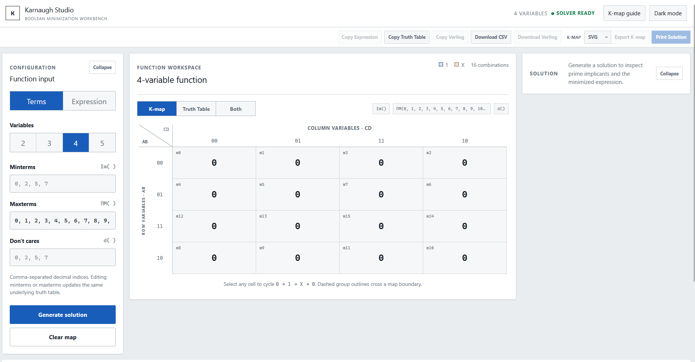
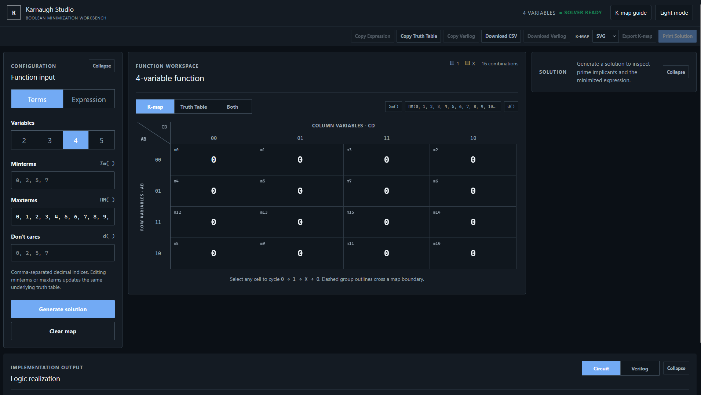

# Project description
>Completed

Website: karnaugh-studio.ishitabhatt.tech

Karnaugh Studio is a browser-based Karnaugh map and digital logic workbench for two through five Boolean variables. It keeps a truth table as the single function state, presents that state as an editable K-map or table, finds exact minimum sum-of-products covers, explains each grouping step, and derives a logic circuit and Verilog from the resulting Boolean AST.


The mathematical engine is pure TypeScript and has no React or browser dependency.

# Features

- Editable 2-, 3-, 4-, and 5-variable K-maps with `0`, `1`, and `X` states
- Synchronized minterm, maxterm, don't-care, truth-table, and K-map input
- Safe Boolean-expression input with implicit or explicit AND, OR, NOT, and parentheses
- Exact prime-implicant and essential-implicant minimization
- Alternative expressions when multiple covers have the same optimal cost
- Solver-derived, step-by-step explanations and group highlighting
- Responsive SVG logic circuits with zoom and fit controls
- Deterministic synthesizable Verilog and optional exhaustive testbench generation
- Clipboard, CSV, Verilog, SVG/PNG K-map, and A4 print exports
- Light and designed dark themes, responsive layouts, keyboard controls, and reduced-motion support
- A concise in-app K-map guide for first-time users

# Architecture

```text
src/
|-- core/                  Pure TypeScript domain and algorithms
|   |-- types/             Shared immutable contracts
|   |-- truthTable/        Truth-table row generation
|   |-- kmap/              Gray code, layouts, coordinates, map construction
|   |-- minimization/      Implicants, exact covers, explanations
|   |-- boolean/           AST, parser, evaluator, formatting, conversions
|   |-- circuit/           AST-to-graph conversion, layout, evaluation
|   `-- verilog/           AST-to-Verilog and testbench generation
|-- components/            Reusable React presentation
|-- pages/                 Workspace composition
|-- hooks/                 Canonical UI state and derived projections
|-- utils/                 Browser export and presentation utilities
`-- tests/                 Cross-module engineering/property tests
tests/e2e/                 Playwright browser flows
```

`src/core` never imports React, the DOM, or browser APIs. The React workspace owns one binary-indexed `TruthValue[]`; maps, summaries, solutions, circuits, HDL, and reports are derived from it. Tests are colocated with their modules, with broader integration/property tests under `src/tests` and browser tests under `tests/e2e`.

# Tech stack

- React 19 and TypeScript 5 with strict compiler settings
- Vite 7
- Tailwind CSS 4 plus application design tokens in `src/styles.css`
- Native SVG for K-map overlays and circuit rendering
- Vitest, React Testing Library, and V8 coverage
- Playwright with Chromium for end-to-end and responsive checks
- ESLint and Prettier

# Running locally

Prerequisites: a current Node.js LTS release and npm.

```bash
npm install
npm run dev
```

Vite prints the local URL. Create a production bundle with `npm run build` and preview that bundle with `npm run preview`.

Playwright may require a one-time browser installation:

```bash
npx playwright install chromium
```

# Testing

```bash
npm test                 # unit, integration, property, and component tests
npm run test:coverage    # instrumented V8 coverage report
npm run test:e2e         # Playwright browser flows
npm run typecheck        # strict TypeScript project build
npm run lint             # ESLint with zero warnings allowed
npm run format:check     # verify Prettier formatting
npm run build            # production TypeScript and Vite build
```

The engineering property suite samples deterministic random functions at every supported variable count and exhaustively compares every defined output with the solver expression, generated circuit, and normalized Verilog expression. Small-map tests also exhaustively cover all two- and three-variable functions.

# K-map algorithm

For `n <= 5`, the minimizer enumerates the complete `3^n` Boolean cube space. A cube pattern contains `0`, `1`, or `-`, where `-` means that a variable changes and is eliminated. A candidate is valid only when every included cell is `1` or `X` and at least one included cell is a required minterm.

A candidate is prime when no larger valid cube contains it. Minterms covered by only one prime identify essential implicants. The remaining prime-implicant chart is searched exactly with branch-and-bound. Covers are ranked first by product-term count and then by literal count; every cover tied at the optimal cost is returned. The cube pattern is authoritative, while displayed coordinates and wrap metadata are projections for visualization.

## Mathematical conventions

- Variables are ordered alphabetically by default: `A`, `B`, `C`, `D`, `E`. Expression mode infers the distinct variable names and sorts them deterministically.
- `A` is the most significant bit. With variables `A,B,C,D`, assignment `0010` is minterm 2 and `1010` is minterm 10.
- Truth-table rows use ordinary ascending binary order from 0 through `2^n - 1`.
- K-map axes use reflected Gray-code order, not binary order. A two-bit axis is `00, 01, 11, 10`, including cyclic adjacency between its first and last entries.
- Four-variable maps place `AB` on rows and `CD` on columns. Five-variable maps use two planes for `C = 0` and `C = 1`, with `AB` rows and `DE` columns.
- Minterms are output-1 indices; maxterms are output-0 indices. `X` cells are don't-cares: they may enlarge an implicant but never need to be covered and never make an all-don't-care function logically 1.
- Opposite K-map edges are adjacent because Gray order is cyclic. A group may wrap horizontally, vertically, or across corners when its logical cube is valid.

# Boolean expression parser

The tokenizer and recursive-descent parser accept an expression alone or an assignment such as `F = A'B + CD`. Supported notation is:

- NOT: `A'`, `~A`, `!A`, `NOT A`
- AND: `AB`, `A*B`, `A AND B`
- OR: `A+B`, `A|B`, `A OR B`
- Parentheses and constants `0` and `1`

NOT has the highest precedence, then AND, then OR. All syntax becomes the same typed AST. Input is never passed to `eval`, `Function`, an HTML injector, or any other code-execution path. Invalid syntax produces a position-aware validation message, and expressions outside the supported two-to-five-variable range are rejected before replacing the current function.

# Circuit generation

The circuit module walks the minimized Boolean AST and builds a directed graph of input, constant, NOT, AND, OR, and output nodes with explicit edges. A deterministic layered layout places inputs on the left, dependencies in depth columns, and the output on the right. Circuit evaluation is independent of AST evaluation and is used in exhaustive equivalence tests.

# Verilog generation

The Verilog generator walks the AST with explicit operator precedence and emits a deterministic combinational module with inferred input declarations and one output. It validates identifiers and can append a testbench that enumerates every input combination for the supported range. HDL is presented, copied, or downloaded in the browser; the application never executes it.

# Screenshots section placeholder

Project screenshots can be added here as the visual design evolves:

```text
docs/screenshots/workspace-light.png
docs/screenshots/workspace-dark.png
docs/screenshots/workspace-mobile.png
```

# Known limitations

- Only functions with two through five distinct variables are accepted.
- Minimization targets two-level sum-of-products forms using NOT, AND, and OR.
- Verilog is structurally and logically tested but is not passed to an external HDL compiler.
- Clipboard, PNG, download, and printing depend on browser support and permissions.
- The application does not persist or synchronize projects through a backend.

# Future work

- Optional product-of-sums minimization and additional gate families
- Saved projects and shareable serialized function links
- A pinned HDL-compiler validation step in development CI
- Automated WCAG scanning, screen-reader matrices, and calibrated visual regression
- Mutation testing around parser recovery and exact-cover selection
